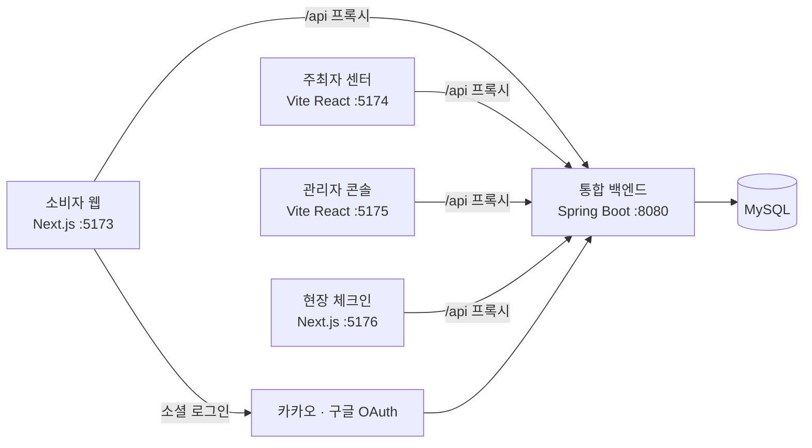

# 팝온 통합 백엔드 (Backend)

소비자 · 주최자 · 관리자 · 현장 체크인, **4개 프론트엔드가 함께 쓰는 단일 API 서버**.


> 담당: 팀원 2명 (백엔드)

<br>

## 기술 스택

| 구분 | 사용 기술 |
|---|---|
| 언어 · 런타임 | Java 21 |
| 프레임워크 | Spring Boot 4.1 (Web MVC, Data JPA, Security, OAuth2 Client, Validation, Mail) |
| DB | MySQL |
| 인증 | JWT (jjwt), 카카오 · 구글 OAuth2 |
| 외부 API | 네이버 클라우드 Maps 지오코딩, 네이버 SENS(문자), 국세청 사업자 진위확인, Gmail SMTP |
| 빌드 · 배포 | Gradle, AWS EC2 (systemd 서비스) |

<br>

## 아키텍처



- 모든 프론트는 API를 상대경로 `/api`로 호출하고, 각자의 개발 서버 프록시(Vite proxy / Next rewrites)가 8080으로 전달합니다. 따라서 브라우저 CORS 문제가 생기지 않습니다.
- 요청 흐름: `Controller → Service → Repository(JPA) → MySQL`, 응답은 Entity를 DTO로 변환해 반환합니다.

<br>

## 인증 구조

역할을 테이블이 아닌 **토큰 형식**으로 구분합니다.

| 역할 | 로그인 방식 | 토큰 |
|---|---|---|
| 소비자 | 카카오 · 구글 OAuth | 소비자용 서명키, `id` 클레임 = 회원 ID |
| 주최자 | 이메일 · 비밀번호 | 직원용 서명키, subject = 사업자 이메일 |
| 관리자 | 이메일 · 비밀번호 (가입 API 없음) | 직원용 서명키, subject = `admin:이메일` |
| 비회원 | 없음 | 현장 웨이팅 등록 등 공개 API만 사용 |

- 보안 필터 체인을 **소비자용 / 공통용 두 개**로 나누고, 서명키도 둘로 분리했습니다. 키가 하나였을 때 서로의 토큰이 서명 검증을 통과해 필터가 다른 역할의 토큰을 자기 것으로 착각하는 문제가 있었기 때문입니다.
- 두 백엔드를 합치면서 같은 이름의 클래스(SecurityConfig, JwtUtil)가 두 벌 생겨, 빈 이름을 패키지 전체 경로로 만드는 `FqnBeanNameGenerator`로 충돌을 해결했습니다.

<br>

## 주요 기능

### 팝업 · 예약 · 웨이팅 (핵심 흐름)
- **팝업 생애주기**: 등록(심사 대기) → 관리자 승인 / 반려 → 오픈 예정 → 진행 중 → 종료, 관리자 게시중지
- **슬롯 자동 생성**: 운영 기간 × 요일별 운영시간 ÷ 슬롯 단위로 예약 슬롯을 한 번에 생성 (여러 번 호출해도 결과가 같은 멱등 처리)
- **사전 예약**: 슬롯 정원 검증 후 확정, 입장용 QR 토큰(UUID) 발급
- **현장 웨이팅**: 회원 · 비회원 등록, 당일 대기번호 발급, 입장 QR을 문자 · 메일로 발송
- **통합 대기열**: 시작 시각이 된 예약을 현장 웨이팅과 합쳐 하나의 보드로 제공 (이름 마스킹)
- **통합 QR 체크인**: 예약 QR과 웨이팅 QR을 하나의 엔드포인트로 입장 처리, 다른 팝업의 QR은 거부
- **실시간 혼잡도 · 예상 대기시간**: 정원 대비 체류 인원으로 여유 / 보통 / 혼잡 판정
- **거래 이벤트 로그**: 예약 · 웨이팅 상태가 바뀔 때마다 기록하는 감사 이력 (append-only)

### 계정 · 콘텐츠 · 운영
- 소비자: 소셜 로그인, 회원정보 · 관심 카테고리 · 관심 지역, 찜, 후기(사진 · 공감 · 신고), 알림 설정, 1:1 문의
- 주최자: 회원가입(국세청 사업자 진위확인 · 약관 동의), 브랜드 정보 · 로고, 관리자 문의
- 관리자: 대시보드 집계, 팝업 심사, 계약 단계 관리, 회원 정지, 카테고리 · 지역 마스터, 배너 · 공지, CS · 신고 처리, 통계
- 이미지 업로드 시 서버에서 리사이즈 · JPEG 변환 (아이콘은 투명 배경 유지)
- 주소 저장 시 지오코딩으로 위경도 자동 저장

### 스케줄러
| 스케줄러 | 주기 | 역할 |
|---|---|---|
| PopupStatusScheduler | 5분 | 시작일 · 종료일에 맞춰 팝업 상태 자동 전환 |
| AutoExitScheduler | 1분 | 평균 체험시간이 지난 입장객 자동 퇴장 처리 |
| DailyQueueResetScheduler | 매일 00:05 | 그날 처리되지 않은 대기를 「미입장」으로 확정하고 다음 날 대기열을 0부터 시작 (기록은 보존) |
| CongestionAlertScheduler | 5분 | 혼잡 상태가 된 팝업의 대기자에게 알림 |
| ReservationTimeReminderScheduler | 10분 | 예약 시간 30분 전 알림 |
| ReservationDayReminderScheduler | 매일 09:00 | 오늘 예약이 있는 소비자에게 알림 |
| PopupDateReminderScheduler | 매일 09:00 | 팝업 오픈 · 종료 하루 전 알림 (찜한 소비자 등) |

<br>

## 패키지 구조

```
src/main/java/popupteam/popupbackend/
├── UnifiedApplication.java
├── config/          # 공통 보안 체인, CORS, 정적 파일(/uploads) 서빙, 빈 이름 충돌 해결
├── security/        # 주최자 · 관리자 JWT 발급 · 검증 필터
├── common/          # 예외 처리, 지오코딩, 이미지 처리, 문자 · 메일 발송, 사업자 진위확인, 파일 저장
└── domain/
    ├── popup        # 팝업 · 슬롯 · 통합 대기열 · 혼잡도 · 대기시간 · 계약 · 대시보드
    ├── reservation  # 예약 (단일 소스)
    ├── waiting      # 현장 웨이팅, 자정 리셋
    ├── consumer     # 소비자 계정 · 관심사 · 소셜 로그인(auth)
    ├── review · wishlist · report · cs · inquiry
    ├── business · admin · notice · announcement · banner
    └── eventlog · visit · venue · terms
```

<br>

## 실행 방법

필요한 것 : **JDK 21**과 **MySQL 8**

```powershell
# 1. DB 만들기 (최초 1회)
mysql -u root -p -e "CREATE DATABASE popupdb DEFAULT CHARACTER SET utf8mb4;"

# 2. 설정 파일 만들기 (비밀번호 · 키는 커밋하지 않음)
Copy-Item src/main/resources/application-example.yml src/main/resources/application.yml
#    → DB 접속 정보, JWT 서명키 2개, OAuth 클라이언트 정보 입력

# 3. 실행 — 첫 실행 때 JPA가 테이블을 자동으로 만듭니다
.\gradlew.bat bootRun

# 4. 최초 1회: 서버를 한 번 띄운 뒤, 관리자 계정 · 기본 키워드 넣기
#    (PowerShell은 < 입력 연결을 지원하지 않아 cmd로 실행)
cmd /c "mysql -u root -p --default-character-set=utf8mb4 popupdb < db-init.sql"
```

서버는 `http://localhost:8080`에서 실행됩니다.

### 주요 설정 항목 (`application.yml`)

| 항목 | 설명 |
|---|---|
| `spring.datasource.*` | MySQL 접속 정보 |
| `jwt.consumer-secret` · `jwt.staff-secret` | 소비자용 · 직원용 서명키 (서로 달라야 함) |
| `spring.security.oauth2.client.*` | 카카오 · 구글 OAuth 클라이언트 |
| `file.upload-dir` | 업로드 파일 저장 경로 (절대경로) |
| `naver.maps.*` | 지오코딩 키 (없으면 좌표 저장만 생략) |
| `nts.api.service-key` | 사업자 진위확인 키 (선택) |
| `spring.mail.*` · `notification.sms.*` | 메일 · 문자 발송 계정 (비워두면 발송 생략, 로그만 남김) |

통합 배경과 상세 결정 과정은 [UNIFICATION-README.md](UNIFICATION-README.md)에 정리되어 있습니다.
