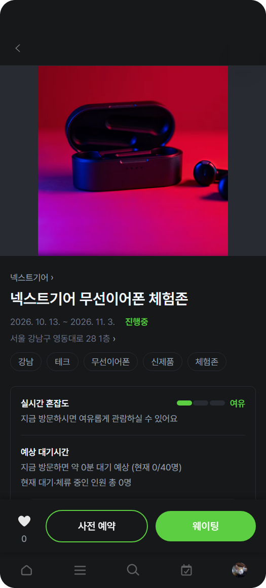

# 팝온 소비자 웹 (customerfrontend)

팝업스토어를 **찾고, 예약하고, 줄 서고, 입장하는** 소비자용 모바일 웹.
팝온 전체 서비스 중 손님이 직접 만나는 화면을 맡고 있습니다.

> 담당: **박은우** (화면 설계 · 프론트엔드 구현)

<p align="center">
  
</p>

<br>

## 기술 스택

| 구분 | 사용 기술 |
|---|---|
| 프레임워크 | Next.js 16 (App Router), React 19 |
| 언어 | TypeScript |
| 스타일 | Tailwind CSS 4, Pretendard |
| 라이브러리 | Embla Carousel (배너 자동 슬라이드), lucide-react (아이콘) |
| 지도 | 네이버 지도 Web Dynamic Map SDK |
| 인증 | 카카오 · 구글 OAuth (백엔드 경유) + JWT |
| 배포 | Next.js `standalone` 빌드 |

UI 컴포넌트 라이브러리 없이 **버튼·체크박스·배지·모달까지 Tailwind로 직접 구현**했습니다.

<br>

## 주요 기능

### 탐색
- **홈**: 프로모션 배너 캐러셀, 카테고리 바로가기, 실시간 혼잡도, "지금 입장하기 좋은 팝업", 지역별 인기 랭킹, 최근 본 팝업, 주변 핫플
- **검색**: 검색어 + 카테고리 · 지역 · 운영 여부 · 별점 다중 필터 (URL 쿼리와 동기화되어 뒤로가기·공유 시에도 필터 유지)
- **지도로 찾기**: 네이버 지도 위에 진행 중 / 운영 예정 팝업 핀 표시, 핀 선택 시 하단 카드
- **랭킹 · 브랜드 · 바로가기**: 찜·후기·클릭 수 기반 인기 순위, 브랜드별 팝업 모음, 카테고리·지역 바로가기

### 팝업 상세
- 대표 이미지 캐러셀, 운영 기간 · 요일별 운영시간 · 위치 · 해시태그 · SNS 링크
- **실시간 혼잡도**(여유 / 보통 / 혼잡 3단 신호 바)와 **예상 대기시간**
- 하단 고정 액션바: 찜, 사전 예약, 웨이팅 (팝업 운영 방식에 따라 버튼 자동 노출)
- 후기 탭: 방문 인증 후기 / 일반 댓글 구분, 최신순·추천순, 사진 후기만 보기, 신고
- 해시태그 · 지역 겹침 점수로 계산한 **비슷한 팝업** 추천

### 예약 · 웨이팅 · 입장
- **사전 예약 모달**: 달력 → 시간대(슬롯) → 인원 선택. 휴무 요일과 이미 지난 시간대는 선택 불가
- **현장 웨이팅**: 로그인 회원 원탭 등록, 대기번호 즉시 발급
- **웨이팅 상세**: 내 순번 4초 주기 갱신, 앞 팀이 0이 되는 순간 진동 + 안내 모달
- **입장 QR**: 예약 상세와 문자로 받은 링크(`/qr/[token]`)에서 QR 표시, 입장 처리되면 자동으로 "입장 완료" 화면 전환
- 예약 일정 변경 · 취소

### 계정 · 마이페이지
- 카카오 / 구글 소셜 로그인 → 회원정보 입력 → 관심 카테고리 · 관심 지역 온보딩
- 마이페이지: 찜 목록, 진행 중 예약·웨이팅, 다녀간 팝업(내 후기), 알림 설정, 1:1 문의, 공지사항, 회원정보 수정 · 탈퇴
- 알림함: 예약 · 웨이팅 · 공지 알림, 누르면 관련 화면으로 이동
- 후기 작성: 별점 + 사진 첨부, 사진은 **1:1 크롭 후 800×800으로 리사이즈**해 업로드
- 다크 모드 기본, 라이트 모드 전환 지원

<br>

## 구현하면서 고민한 부분

### 1. 지도 핀 겹침 문제
같은 건물에 팝업이 여러 개 있거나 지도를 축소하면 핀이 겹쳐서 원하는 팝업을 누를 수 없는 문제가 발생해 아래와 같이 해결했습니다.

- **같은 좌표**: 소수점 4자리(약 11m) 기준으로 묶은 뒤, 고정 시드 기반으로 9~22m 범위에 흩어 배치 (매번 같은 위치에 그려지도록 시드 고정, 원형 배치는 기계적으로 보여서 제외)
- **화면 축소 시**: 픽셀 거리 기준으로 가까운 핀을 묶어 **숫자 뱃지 클러스터**로 표시하고, 클러스터를 누르면 핀이 각각 눌릴 만큼 확대. 지도 이동이 끝날 때(`idle`)마다 다시 계산
- 선택한 핀은 항상 맨 위에 그리고, 지도 인증 실패 시 화면 전체가 깨지지 않도록 별도 안내로 대체

### 2. 백엔드가 꺼져 있어도 화면은 보이게
팀 개발 중 백엔드가 재시작되거나 연결이 끊기는 일이 잦아서, 공통 API 클라이언트(`lib/api/client.ts`)를 설계했습니다.

- **네트워크 실패**와 **실제 API 오류(404 등)** 를 구분
- 연결 자체가 안 될 때만 목업 데이터로 화면을 유지하고, 상단에 연결 상태 배너 표시
- 존재하지 않는 팝업처럼 정상적인 404는 목업으로 덮지 않고 그대로 처리
- 401 응답이 오면 토큰 · 사용자 정보 · 찜 캐시까지 한 번에 정리하는 전체 로그아웃

### 3. 잘못된 예약을 화면 단계에서 막기
- 달력에서 휴무 요일은 운영 기간 안이어도 선택 불가 (흐리게 + 취소선)
- 오늘 날짜를 고르면 이미 지난 시작 시각의 슬롯은 비활성
- 같은 팝업 · 날짜 · 시간대 중복 예약 차단, 휴무일은 제출 시점에 한 번 더 확인
- 예약 생성과 일정 변경이 같은 모달을 쓰되, 모드에 따라 문구를 분리해 "새로 예약하는 것처럼 보이는" 문제 해결

### 4. 모바일 사용성
- 모달이 열려 있을 때 모바일 터치 스크롤이 뒤 화면으로 새는 문제를 body 고정 방식으로 해결
- 쿼리(`?action=reservation`, `?tab=review`, `?menu=공지사항`)로 진입하면 해당 모달·탭이 바로 열리도록 해서, **현장 QR · 알림 · 다른 앱에서 바로 원하는 화면으로 연결**

<br>

## 폴더 구조

```
customerfrontend/
├── app/                    # 라우트 (App Router)
│   ├── page.tsx            # 홈
│   ├── search/             # 검색
│   ├── map/                # 지도로 찾기
│   ├── popup/[id]/         # 팝업 상세, review/ 후기 작성
│   ├── reservations/[id]/  # 예약 상세 (QR · 변경 · 취소)
│   ├── waiting/[id]/       # 웨이팅 상세 (순번 · QR)
│   ├── qr/[token]/         # 문자로 받은 입장 QR
│   ├── login/ · signup/    # 소셜 로그인, 회원정보 · 관심사 온보딩
│   ├── mypage/             # 마이페이지 허브
│   ├── notifications/      # 알림함
│   └── ranking/ · brand/ · easy-entry/ · recent/ · more/ · notice/
├── components/
│   ├── home/               # 홈 섹션 (캐러셀, 랭킹, 후기 등)
│   ├── popup/              # 상세 · 예약 · 웨이팅 모달, 혼잡도, 이미지 크롭
│   ├── search/             # 검색창, 필터 패널, 최근 검색어
│   ├── layout/             # 헤더, 하단 탭바, 백엔드 상태 배너
│   └── ui/                 # 직접 만든 공용 UI (Checkbox, HeartButton, StatusBadge ...)
├── lib/
│   ├── api/                # 도메인별 API 함수 + 공통 클라이언트
│   ├── auth/               # AuthContext (로그인 상태 전역 관리)
│   ├── theme/              # 다크 / 라이트 테마
│   └── utils/              # 날짜 · 전화번호 포맷, 상태 라벨 등
├── data/                   # 목업 데이터, 약관 본문
└── public/icons/           # 아이콘 (SVG)
```

<br>

## 실행 방법

```powershell
npm install
Copy-Item .env.example .env.local   # 값 채우기 (아래 참고)
npm run dev
```

`http://localhost:5173`에서 열립니다. 통합 백엔드(`localhost:8080`)가 켜져 있어야 실제 데이터가 보이고, 꺼져 있으면 목업 데이터로 화면만 확인할 수 있습니다.

API 요청은 상대경로(`/api/...`)로 나가고, `next.config.ts`의 rewrites가 백엔드로 프록시합니다. 브라우저 CORS 설정은 따로 필요하지 않습니다.

### 환경변수 (`.env.local`)

| 이름 | 필수 | 설명 |
|---|---|---|
| `NEXT_PUBLIC_NAVER_MAP_CLIENT_ID` | O | 네이버 지도 Client ID. 없으면 `/map`에서 안내 문구만 표시 |
| `BACKEND_ORIGIN` | | 프록시할 백엔드 주소 (기본 `http://localhost:8080`) |
| `NEXT_PUBLIC_OAUTH_BASE` | | 소셜 로그인 시 이동할 백엔드 주소 (기본 `http://localhost:8080`) |
| `NEXT_PUBLIC_API_BASE_URL` | | API 앞부분. 평소엔 비워두면 rewrites 사용 |
