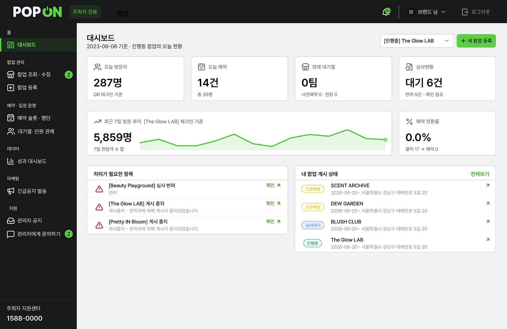

# 팝온 주최자 센터 (popupfrontend)

브랜드 · 셀러가 **팝업을 등록하고, 예약자와 현장 대기열을 관리하고, 성과를 확인하는** 주최자용 웹이에요.
폴더 이름은 `popupfrontend`지만 **주최자(셀러) 전용 앱**이에요.

> 담당: 팀원 (주최자 · 관리자 프론트엔드)

<p align="center">
  
</p>

<br>

## 기술 스택

| 구분 | 사용 기술 |
|---|---|
| 빌드 | Vite 6 |
| 프레임워크 | React 18, React Router 7 |
| 언어 | TypeScript |
| 스타일 | Tailwind CSS 4, Radix UI 기반 컴포넌트 (shadcn/ui 구성) |
| 차트 · 폼 | Recharts, React Hook Form |
| QR | qrcode.react (생성), jsQR (스캔) |
| 지도 | 네이버 지도 SDK · 지오코딩 |

초기 화면은 Figma Make로 생성한 코드 번들에서 시작해 실제 API와 연결하며 확장했어요.

<br>

## 구성

하나의 앱 안에 성격이 다른 세 영역이 있어요.

| 경로 | 영역 | 설명 |
|---|---|---|
| `/` | 정보 사이트 | 주최자 대상 서비스 소개 랜딩, 로그인 · 회원가입 |
| `/seller/*` | 주최자 센터 | 로그인 후 쓰는 운영 콘솔 (사이드바 레이아웃) |
| `/walkin` | 비회원 웨이팅 폼 | 현장 QR로 진입하는 공개 페이지 |

<br>

## 주요 기능

### 정보 사이트
- 실제 팝업 DB 기반 추천 · 신규 · 전체 팝업 그리드 (클릭 시 소비자 앱 상세로 이동)
- 팝업 등록 절차와 예약 · 웨이팅 통합 관리 소개 원페이지
- **3단계 회원가입**: 계정 정보 → 사업자 확인(국세청 사업자 진위 확인) → 주최자 상세 정보

### 주최자 센터
- **대시보드**: 대표 팝업 기준 오늘 방문자 · 예약 · 대기열 · 심사 현황, 7일 방문 추이, 처리 필요 항목
- **팝업 등록**: 기간 · 요일별 운영시간 · 슬롯 단위 · 정원 · 운영 방식(사전예약 / 웨이팅) 입력, 주소 검색은 네이버 지오코딩, 임시저장 지원
- **팝업 조회 · 상세**: 심사 상태(승인 대기 / 오픈 예정 / 진행 중 / 반려 / 게시중지) 확인, 삭제는 상세에서만 가능
- **예약 관리**: 날짜 · 슬롯별 예약 현황(n / 정원), 예약자 명단에서 체크인 · 노쇼 처리
- **대기열 · 인원 관제**: 사전예약과 현장 웨이팅을 하나로 합친 **통합 대기열 보드**(30초 폴링), 입장 · 취소 · 퇴장 처리, 현재 체류 인원 표시
- **성과 대시보드**: 체크인 기준 방문자 통계, 클릭 대비 예약 전환율
- **긴급공지 발송**: 팝업을 선택해 예약자에게 공지 발송, 발송 이력 조회
- **지원**: 관리자에게 문의 · 답변 확인, 관리자 공지 수신함, 마이페이지(브랜드 정보 · 로고 · 비밀번호)

<br>

## 폴더 구조

```
popupfrontend/src/app/
├── routes.tsx          # 라우트 정의
├── info/               # 정보 사이트 (랜딩, 로그인, 회원가입, 팝업 관리 소개)
├── seller/             # 주최자 센터
│   ├── SellerRoot.tsx  # 사이드바 · 상단바 · 알림 벨 레이아웃
│   └── pages/          # 대시보드, 팝업 등록 · 조회, 예약, 대기열 관제, 성과, 공지, 문의
├── walkin/             # 비회원 현장 웨이팅 폼
├── lib/                # API 래퍼(api.ts), 슬롯 자동생성, 사이드바 뱃지 등
├── context/            # AuthContext
└── components/ui/      # Radix 기반 공용 컴포넌트
```

<br>

## 실행 방법

```powershell
npm install
Copy-Item .env.example .env.local   # 값 채우기
npm run dev
```

`http://localhost:5174`에서 열려요. `/api`, `/uploads` 요청은 Vite 프록시가 통합 백엔드(`localhost:8080`)로 전달해요.

| 환경변수 | 필수 | 설명 |
|---|---|---|
| `VITE_NAVER_MAP_CLIENT_ID` | O | 팝업 등록 폼의 주소 검색 · 지도 미리보기 |
| `VITE_API_TARGET` | | 프록시할 백엔드 주소 (기본 `http://localhost:8080`) |
| `VITE_CONSUMER_URL` · `VITE_ADMIN_URL` | | 배포 빌드 시 다른 앱으로 연결되는 링크 주소 |
