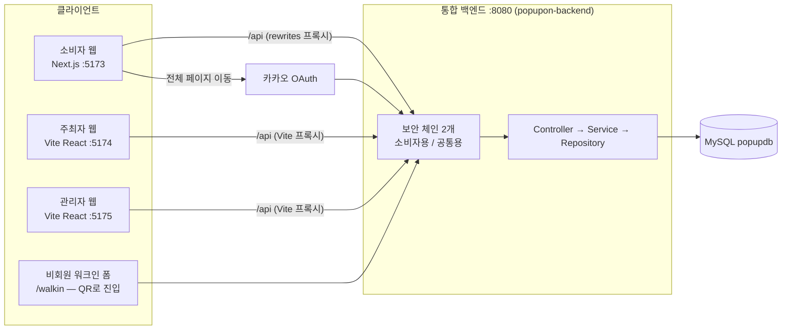
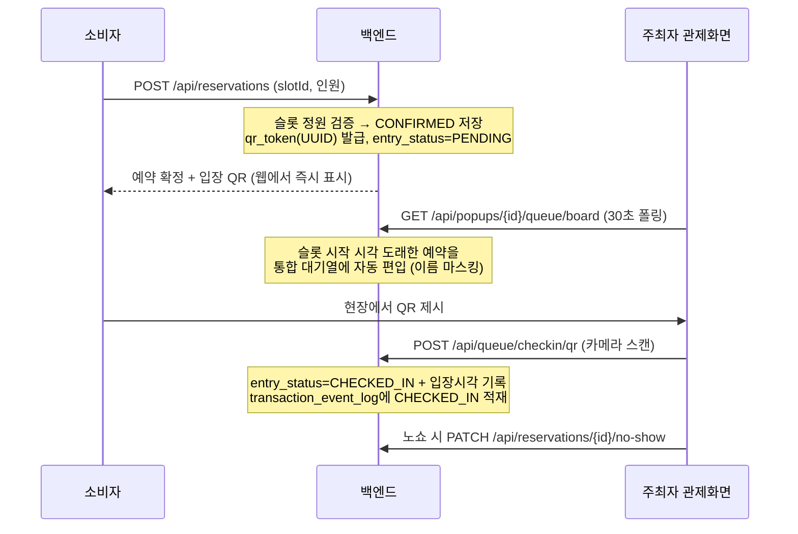

# 팝업온(PopupOn) — 프로젝트 종합 명세

> 기준: `unified` 브랜치 (2026-07-22, 백엔드 통합 이후). 이 문서 하나로 **무엇이 구현되어 있고, 어떤 흐름으로 동작하며, 각 디렉토리·파일이 무슨 역할인지**를 파악할 수 있도록 작성했다.

**한 줄 소개** — 팝업스토어계의 쿠팡: **주최자**(브랜드·셀러)가 팝업을 등록·운영하고, **소비자**가 탐색·예약·웨이팅·리뷰하고, **관리자**(플랫폼 본사)가 심사·공간 매칭·계약·CS를 담당하는 3주체 플랫폼.

---

## 1. 저장소 지도

```
popup-store-project/
├── Backend/                    ← 통합 백엔드 (Spring Boot 4.1, Java 21, 포트 8080 단일)
│   ├── src/main/java/popupteam/popupbackend/   (상세는 §4)
│   ├── src/main/resources/     application-example.yml(설정 템플릿)·application.yml(로컬 생성, 미커밋)
│   ├── db-init.sql             관리자 계정·키워드 시드 + 구 테이블 정리 (멱등)
│   ├── README.md               실행법·인증 체계·패키지 오너십·팀원 Pull 체크리스트
│   └── UNIFICATION-README.md   두 백엔드 통합 결정 기록 (비교표·이동표)
├── Frontend/
│   ├── popupfrontend/          ← 주최자 웹 (Vite + React, 포트 5174)
│   ├── adminfrontend/          ← 관리자 웹 (Vite + React, 포트 5175 — 7/24 popupfrontend에서 분리)
│   └── customerfrontend/       ← 소비자 웹 (Next.js 16, 포트 5173)
└── uploads/                    업로드 이미지 저장소 (백엔드 실행 위치 기준)
```

- 세 프론트 모두 API를 **상대경로 `/api`로 호출**하고, 각자의 dev 프록시(Vite proxy / Next rewrites)가 8080으로 전달한다 → 브라우저 CORS가 원천적으로 발생하지 않음.
- 원래 백엔드는 popupbackend(8080)·customerbackend(8081) 2개였으나 **7/22 하나로 통합** — 배경과 방법은 `Backend/UNIFICATION-README.md` 참고.

---

## 2. 아키텍처와 데이터 흐름

### 2-1. 전체 구성도



### 2-2. 요청 처리 파이프라인 (모든 API 공통)

```
화면 컴포넌트
 → API 래퍼 (popupfrontend: lib/api.ts request() / customerfrontend: lib/api/client.ts apiFetch())
    · JSON 직렬화 + Authorization: Bearer JWT 자동 첨부
 → dev 프록시 (/api → localhost:8080)
 → [보안 체인 선택]
    · /oauth2/**, /login/**, /api/customer/** → 소비자 체인 (domain/consumer/auth/SecurityConfig, @Order(1))
    · 그 외 전부                              → 공통 체인 (config/SecurityConfig)
 → JwtAuthenticationFilter: 서명·만료 검증 → subject를 인증 컨텍스트에 적재
 → Controller: 역할·소유자 재검증 (admin: 접두사 검사, 내 팝업인지 확인 등)
 → Service: 비즈니스 규칙 (정원 검증, 상태 전이, QR 발급, 이벤트 로그 기록)
 → Repository(JPA) → MySQL
 → Entity → Response DTO 변환 → JSON 응답
```

### 2-3. 인증 — "역할 = 토큰 형식" (테이블이 아니라 토큰으로 구분)

| 역할 | 토큰 구조 | 발급 | 검증 위치 |
|---|---|---|---|
| 주최자 | subject = 사업자 이메일 | `POST /api/business/auth/login` | 공통 체인 필터 + 컨트롤러 소유자 검증 |
| 관리자 | subject = `admin:이메일` | `POST /api/admin/auth/login` | 컨트롤러가 `startsWith("admin:")` 검사 |
| 소비자 | subject 없음, claim `id`=customerId | 카카오 OAuth 성공 핸들러 | 소비자 컨트롤러가 헤더 직접 파싱 |
| 비회원 | 토큰 없음 | — | permitAll 엔드포인트만 사용 (웨이팅 등록 등) |

JWT 시크릿은 하나(yml). 관리자 계정은 가입 API가 없어 `db-init.sql`로 시드.

### 2-4. 핵심 시나리오 흐름 3종

**① 소비자 예약 → 주최자 입장 처리 (플랫폼의 중심 흐름)**



**② 현장 웨이팅 (회원/비회원) — 원격 줄서기를 현장 QR 방식으로 재정의**

```
현장 비치 QR 2종
 ├ 회원용  → 소비자 웹 팝업 상세에서 웨이팅 등록
 └ 비회원용 → /walkin 공개 폼 (이름·전화·이메일 필수)
       ↓ POST /api/popups/{id}/waiting (permitAll)
백엔드: 당일 대기번호 발번 + qrToken 발급 → 앞 대기 팀 수 응답
       (메일·문자 발송은 발송 계정 설정 시 실발송)
주최자 관제: 통합 보드에서 예약·웨이팅 한 화면 관리
 · 입장 = QR 스캔(통합 체크인) 또는 수동  · 취소  · 15분 초과 자동취소(스케줄러)
 · 호출 기능은 기획에서 폐지
```

**③ 팝업 생애주기 (주최자 등록 → 관리자 심사 → 운영 → 계약 관리)**

```
주최자 등록(POST /api/popups: 기간·운영시간·슬롯단위·정원·운영방식 3택)
  → 상태 PENDING → 관리자 심사(승인 PUT .../approve → BEFOR → OPEN / 반려 → REJECTED)
  → 게시중지 = 반려 API 재사용 + rejectReason "[게시중지]" 마커
  → 승인 후 슬롯 자동 일괄생성 (POST .../slots/generate — 운영기간×운영시간÷슬롯단위, 멱등)
  → 등록·수정 시 GeocodingService가 주소→위경도 자동 저장
계약: 관리자가 계약금·단계 관리(CONTRACTED→IN_CONSTRUCTION→SETTLED)
  → 주최자는 조회 전용 4단계 스텝퍼로 확인 (「운영중」은 프론트 로컬 플래그)
공간 매칭: 주최자가 파트너 공간에 미팅 신청 → 관리자가 상태 관리(REQUESTED→IN_PROGRESS→CONTRACTED)
```

---

## 3. DB 설계 (MySQL popupdb — 28 테이블)

스키마는 JPA `ddl-auto: update`가 엔티티 기준 자동 생성. **테이블별 쓰기 주체는 하나**가 원칙.

### 3-1. 팝업·운영 코어 (jsw 소유)

| 테이블 | 역할 | 핵심 컬럼·규칙 |
|---|---|---|
| `popup` | 팝업 마스터 | 상태 PENDING→BEFOR(팀 표기)→OPEN→CLOSED/REJECTED(+rejectReason), reservationMode(SLOT/FREE), capacity(최대 수용), avgExperienceMinutes, latitude/longitude(지오코딩) |
| `popup_image` | 팝업 이미지 | sortOrder로 썸네일/상세 구분 |
| `popup_slot` | 예약 슬롯 | 날짜·시간대·정원. 등록정보 기준 서버 일괄생성(멱등, 구슬롯 정리). FREE 모드는 슬롯 없음 |
| `popup_reservation` | **예약 단일 소스** | slot_id(SLOT)/reservation_date(FREE), status CONFIRMED/CANCELLED, **entry_status** PENDING/CHECKED_IN/NO_SHOW, **qr_token**(UUID·UNIQUE), checked_in_at/by, cancel_reason. 「이용완료」는 별도 status가 아니라 entry_status로 표현 |
| `waiting_queue` | 현장 웨이팅 | 당일 대기번호, 회원(customerId)/비회원(이름·전화·이메일), qrToken, 상태(WAITING/ENTERED/CANCELLED), 15분 초과 자동취소 |
| `venue` | 공간(대관처) 마스터 | 위치·면적·일 대관료·시설·사진, 좌표 |
| `venue_meeting_request` | 공간 대관 미팅 | REQUESTED→IN_PROGRESS→CONTRACTED/CANCELLED |
| `popup_contract` | 계약 | 계약금·메모·stage(CONTRACTED/IN_CONSTRUCTION/SETTLED) |
| `transaction_event_log` | 거래 원장 (append-only) | popupId·대상(RESERVATION/WAITING)·이벤트(CANCELLED/CHECKED_IN/NO_SHOW/ENTERED/AUTO_CANCELLED…)·actor·시각. 예약·웨이팅 상태 변화 시 서비스가 자동 기록.|

### 3-2. 계정·플랫폼 운영 (jsw 소유)

| 테이블 | 역할 |
|---|---|
| `business` | 주최자(사업자) 계정 — 가입 즉시 활성 (파트너 사전 승인 폐지) |
| `admin` | 관리자 계정 (가입 API 없음 — db-init.sql 시드, BCrypt) |
| `terms` / `business_consent` | 약관 본문 / 주최자 동의 이력(재동의 필요 여부 판단) |
| `cs_request` | 소비자 문의 (접수·답변) |
| `organizer_inquiry` | 주최자→관리자 문의 (답변·이력) |
| `review_report` | 후기 신고 (사유·상세·처리자·처리시각) |
| `platform_visit_log` | 방문 로그 (프론트 로드 시 1회 기록 → 대시보드 방문자 추이) |

### 3-3. 소비자 (jmy 소유 — 구 customerbackend에서 편입)

| 테이블 | 역할 |
|---|---|
| `customer` | 소비자 계정 (카카오 OAuth: provider+providerId UNIQUE, 닉네임, 온보딩 여부) |
| `keyword` / `customer_keyword` | 관심 키워드 마스터(8종 시드) / 소비자별 선택 |
| `popup_wishlist` | 찜 (customerId+popupId) |
| `review` / `review_image` / `review_like` | 별점·후기 / 첨부 사진 / 공감 |


- 특이 구조 하나: `customer` 테이블은 엔티티가 2개다 — `domain/customer/Customer`(예약·웨이팅의 FK 참조용)와 `domain/consumer/Customer`(@Entity명 CustomerAccount, 계정 관리용). 과도기 중복으로 추후 단일화 예정.

---

## 4. 백엔드 상세 (`Backend/src/main/java/popupteam/popupbackend/`)

### 4-1. 진입·공통

| 위치 | 주요 파일 | 무엇을 하며 왜 중요한가 |
|---|---|---|
| 루트 | `UnifiedApplication.java` | 메인. `@SpringBootApplication(nameGenerator=FqnBeanNameGenerator)` — 통합으로 동명 클래스(SecurityConfig·JwtUtil 2벌)가 생겨 빈 이름을 패키지 전체 경로로 생성해 충돌을 막는다. `@EnableScheduling`으로 웨이팅 자동취소 스케줄러 가동 |
| `config/` | `SecurityConfig.java` | **공통 보안 체인**: permitAll 목록(팝업 조회·웨이팅 등록·큐 보드·live-status·`/error` 등)과 나머지 인증 필수를 선언. `/error` permitAll은 "미처리 예외가 403 빈 응답으로 둔갑"하는 스프링 함정의 해결책 |
| | `WebConfig.java` | `/uploads/**` → 업로드 폴더 정적 서빙 |
| | `FqnBeanNameGenerator.java` | 위 빈 이름 충돌 해소기 (통합 셸의 핵심 10줄) |
| `security/` | `JwtUtil.java` / `JwtAuthenticationFilter.java` | 주최자·관리자 토큰 발급·검증. 필터는 subject를 인증 컨텍스트에 넣기만 하고, 역할 판정은 컨트롤러가 담당(단순함 우선 설계) |
| `common/exception/` | `GlobalExceptionHandler.java` | IllegalArgument→400, Forbidden→403, **DataIntegrityViolation→409**(자식 데이터 있는 삭제 시도를 명확한 메시지로) |
| `common/geocoding/` | `GeocodingService.java` | 주소→위경도 변환. 팝업·공간 저장 시 자동 호출 |
| `common/notification/` | `EmailNotificationService.java`·`SmsNotificationService.java` | 입장 QR·순서 임박 발송. **yml에 mail 섹션 없으면 기동 실패**, 계정 비우면 발송 스킵(로그만) |
| `common/upload/` | `FileUploadController.java` | `POST /api/customer/files/upload` — 리뷰 사진 업로드 |

### 4-2. 도메인별 (컨트롤러 = API 표면)

**domain/popup — 팝업 코어 (가장 큰 도메인)**
- `PopupController`: `GET/POST /api/popups`, `GET /my`(주최자), `GET/PUT/DELETE /{id}`, `POST /{id}/images`. 삭제는 슬롯·이미지 선정리 후 실행하되 **예약이 하나라도 있으면 거부**(기록 보존 정책)
- `PopupSlotController`: `GET·POST /slots`, **`POST /slots/generate`** — 운영기간×운영시간÷슬롯단위로 전체 슬롯을 1콜 멱등 생성(2주 팝업 약 390슬롯 검증). 프론트가 슬롯당 반복 호출하던 것을 서버 위임으로 바꾼 핵심
- `UnifiedQueueController`: **`GET /queue/board`** — 사전예약(슬롯 시작 도래분)을 자동 편입한 통합 대기열(마스킹 포함), **`POST /api/queue/checkin/qr`** — 예약·웨이팅 구분 없이 qrToken 하나로 입장 처리
- `PopupLiveStatusController`: `GET /live-status` — capacity 대비 추정 체류 인원으로 여유/보통/혼잡 라벨 (permitAll, 소비자 상세용)
- `PopupWaitTimeController`: `GET /wait-time` — 예상 대기시간
- `PopupContractController`: 계약 조회(주최자)·계약금 등록 PUT·단계 전환 PATCH(관리자)
- `AdminDashboardController`: `GET /api/admin/dashboard` — 미처리 건수·방문자 추이 등 관리자 홈 집계
- `PopupRevenueStatsController`: `GET /api/admin/stats/revenue`

**domain/reservation — 예약 (단일 소스)**
- `ReservationController`: `POST /api/reservations`(정원 검증+qrToken 발급), `GET /me?customerId=`(permitAll — 데모 편의), `GET /popup/{id}`(주최자 명단), `PATCH /{id}/cancel·checkin·no-show`, `POST /checkin/qr`. 취소해도 명단에 「예약취소」로 남기고 대기열엔 미편입
- `PopupStatsController`: `GET /api/admin/stats/popup-ranking`
- 상태 변화마다 `TransactionEventLogService.log()` 호출 — 감사 추적의 원천

**domain/waiting — 현장 웨이팅**
- `WaitingQueueController`: `POST /api/popups/{id}/waiting`(permitAll — 비회원 접수), `GET /waiting/board`, `GET·PATCH /api/waiting/{id}` (enter/cancel/call), `POST /api/waiting/checkin/qr`
- `WaitingAutoCancelScheduler`: 15분 초과 미입장 자동취소 (이벤트 로그 AUTO_CANCELLED)

**domain/venue — 공간·대관**
- `VenueController`: 공간 목록·상세(공개), 등록·수정·삭제(관리자)
- `VenueMeetingController`: 미팅 신청(주최자)·내 신청 목록·전체 목록/상태 변경(관리자)

**domain/admin·business — 계정**
- `AdminController`: 관리자 로그인 (subject `admin:이메일`)
- `AdminPopupController`: `PUT /{id}/approve·reject` — 심사. 게시중지는 reject 재사용
- `BusinessController`: 주최자 signup(약관 동의 필수)/login/me/password/재동의(consent)

**domain/cs·inquiry·report — CS 계열**
- `CsRequestController`(소비자 문의), `OrganizerInquiryController`(주최자 문의), `ReviewReportController`(후기 신고 `POST /api/reports?customerId=` + 관리자 처리)

**domain/terms·visit·eventlog**
- `TermsController`(약관 조회·관리), `VisitLogController`(방문 기록·통계), `EventLogController`(`GET /api/admin/popups/{id}/event-log` — 팝업별 감사 이력, 관리자 전용)

**domain/consumer·review·wishlist — 소비자 도메인 (jmy, 구 customerbackend)**
- `consumer/auth/`: `CustomOAuth2UserService`(카카오 프로필로 customer upsert) → `OAuth2SuccessHandler`(JWT 발급 후 5173으로 리다이렉트) → `JwtUtil`(id 클레임 발급·파싱) → `SecurityConfig`(소비자 체인 — securityMatcher로 담당 구역 한정)
- `CustomerController`(`/api/customer/me` 조회·수정·탈퇴), `InterestController`(관심 키워드 저장)
- `review/ReviewController`: 후기 CRUD·공감(`/{id}/like`) — 조회는 쿼리 파라미터 방식
- `wishlist/WishlistController`: 찜 등록·해제·목록

---

## 5. 프론트엔드 상세

### 5-1. popupfrontend (주최자, :5174) · adminfrontend (관리자, :5175)

> 7/24 관리자 콘솔이 `Frontend/adminfrontend`(:5175) 별도 앱으로 분리됨. 아래 내용 중 `/admin` 라우트·관리자 화면은 adminfrontend에, 나머지는 popupfrontend에 있다. `lib/`·`components/ui` 등 공용 모듈은 양쪽에 동일 사본으로 존재한다.

**공용 모듈 (`src/app/lib/`)** — 이 앱의 중추:

| 파일 | 역할 |
|---|---|
| `api.ts` | 전 API 래퍼. JWT 자동 첨부, 401/403 처리(로컬 토큰 exp를 확인해 "세션 만료"와 "연관 데이터 제약"을 구분 — 403 빈 응답 오인 방지), `popupon:auth-expired` 커스텀 이벤트 발행(레이아웃이 받아 자동 로그아웃), 전체 타입 정의 |
| `navBadges.ts` | 사이드바 [N] 뱃지 — 항목 키를 라우트별 localStorage에 저장, 메뉴 진입 시 즉시 해제 |
| `slotAutoGen.ts` | `ensureSlots()` — 서버 slots/generate 1콜 위임 래퍼 |
| `adminPopupMeta.ts` | 상태 확정일·관리자 수정사항·게시중지 마커(데모용 localStorage, 관리자↔주최자 화면 공유) |
| `contractStages.ts` | 계약 4단계 UI 매핑 (백엔드 3단계 + 「운영중」 로컬 플래그) |
| `customerInquiries.ts` | 소비자→주최자 문의 로컬 데모 (백엔드 API 명세 주석 포함) |
| `walkinQueue.ts` | 운영모드(OpsMode)·퇴장 기록·입장완료 웨이팅 로컬 기록 (백엔드 미비분만 보완) |

**관리자 콘솔 (`admin/`)** — 로그인 가드, 헤더에 JWT 세션 카운트다운·알림 벨:
`AdminDashboard`(실데이터 집계·방문 추이) · `AdminPopups`(심사 승인/반려·게시중지·수정 진입 통합) · `AdminPopupEdit`(수정사항 필수 기록→주최자 표시) · `AdminContracts`(계약금 등록·4단계 전환) · `CS`(소비자 문의/주최자 문의/후기 신고 3탭) · `PlatformStats` · `Businesses`(주최자 현황) · `Accounts`·`Members`·`Masters`·`ContentManage`(부분 데모)

**주최자 센터 (`seller/`)** — 사이드바 뱃지(심사 결과·문의 답변):
`PopupRegister`(기본 기간 오늘~+2주·상세 JPG·운영방식 3택·공간 선택→등록 시 슬롯 자동생성) · `PopupList`(상태·확정일·관리자 수정·문의 버튼) · `Reservations`(슬롯 현황 n/정원·예약자 명단 체크인/노쇼·「예약취소」 유지) · **`WaitingControl`(관제 핵심: 통합 보드 30초 폴링, 카메라 QR 스캔[jsQR]·수동 입장·노쇼[슬롯종료+5분]·체류 인원·QR 2종 발급)** · `Quotes`(계약 조회 스텝퍼) · `PartnerVenues`(공간 탐색·예약 스케줄·미팅 신청 대상) · `Inquiries`(문의하기·재문의) · `CustomerInquiries`(문의받기) · `SellerDashboard`·`Performance`·`Products`·`Notices`(부분 데모)

**정보 사이트 (`info/`)**: `Home`·`WaitingManagement`(제품 소개)·`Login`(3역할 분기·재동의 처리)·`ContentRegister`
**`walkin/WalkinPage.tsx`**: 비회원 웨이팅 공개 폼 — QR로 진입, 서버 대기번호·앞 팀 수·입장 QR 표시

### 5-2. customerfrontend (소비자, :5173 — pew)

- `lib/api/`: `client.ts`(apiFetch — 상대경로+토큰), `auth.ts`(카카오/구글 리다이렉트·온보딩), `customer.ts`·`popups.ts`·`notifications.ts`
- 라우트: `/`(홈 — 캐러셀·카테고리·추천 섹션) · `/search` · `/popup/[id]`(상세·리뷰) · `/popup/[id]/review`(작성) · `/reservations`·`/reservations/[id]` · `/waiting/[id]` · `/mypage` · `/login`·`/login/success`(토큰 수신) · `/signup`·`/signup/preferences`(관심 키워드) · `/brand/[id]` · `/notifications`
- 연동 현황: **로그인·온보딩·계정은 실연동**, 홈·상세·예약·웨이팅 화면은 UI 완성 + 목업 데이터 (실연동 시 rewrites 덕에 경로만 맞추면 됨)

---

## 6. 역할별 "지금 되는 것" 총목록 (구현 완료 기준)

**소비자**
- 카카오 소셜 로그인 → 닉네임·연락처 온보딩 → 관심 키워드 선택 / 회원정보 수정·탈퇴
- 팝업 목록·상세 조회, 혼잡도 확인, 슬롯별 예약 가능 여부 확인 (API 기준)
- 예약 생성(정원 검증)·취소 → **입장 QR 즉시 발급** / 현장 웨이팅 등록(회원·비회원)
- 후기 작성(별점·사진)·수정·삭제·공감, 후기 신고, 찜, 소비자 문의

**주최자**
- 가입(약관 동의) 즉시 활성 → 팝업 등록(운영시간·슬롯단위·정원·운영방식) → 심사 결과 확인(뱃지)
- 승인 시 **슬롯 자동 생성** → 슬롯별 예약 현황(n/정원) → 예약자 명단(체크인/노쇼/예약취소 표기)
- **실시간 관제**: 예약+웨이팅 통합 보드, 카메라 QR 스캔 입장, 체류 인원, 비회원 접수 QR 비치
- 파트너 공간 탐색 → **대관 미팅 신청** → 계약 진행 단계 확인 / 관리자에게 문의·재문의

**관리자**
- 대시보드(미처리 건수·방문자 추이) → 팝업 심사·게시중지·내용 수정(사유 기록)
- 공간 마스터 CRUD, 미팅 신청 상태 관리, **계약금 등록·단계 전환**
- CS 3종(소비자 문의·주최자 문의·후기 신고) 접수·답변·처리
- 팝업별 **거래 이벤트 로그**(감사 이력) 조회 API, 약관 관리, 매출·랭킹 통계 API

---

## 7. 미구현·로컬 데모 (정직한 경계선)

| 항목 | 현재 상태 |
|---|---|
| 예약 변경(슬롯 이동) | 백엔드 미구현 (취소 후 재예약으로 대체 가능) |
| 소비자 화면 실연동 | 예약·웨이팅·홈 섹션이 목업 — API는 전부 준비됨 |
| 인앱 알림함, FAQ, 프로모션·쿠폰, 브랜드 페이지, 방문이력 | 미착수 (WBS 8/4~ 계획) |
| 스탬프·설문·굿즈·긴급공지·법인 정산·매거진·배너 | 미착수 (후순위) |
| 운영모드·퇴장기록·소비자→주최자 문의·상태확정일 | 프론트 localStorage 데모 (연동 지점 주석 명세 有) |
| 계약 「운영중」 단계 | 백엔드 enum 3단계뿐 — 프론트 로컬 플래그로 표현 |
| 문자·메일 실발송 | 발송 계정(yml) 설정 시 동작, 미설정 시 스킵 |
| 카카오 로그인 | 콘솔 Redirect URI 8080 재등록 후 동작 |

---

## 8. 실행·온보딩

`Backend/README.md`의 **"팀원 Pull 후 체크리스트"** 참조 — 요약: ① `application-example.yml` 복사→`application.yml`(비밀번호) ② IntelliJ에 `Backend/build.gradle` 연결 후 `UnifiedApplication` 실행 ③ 1회 기동 후 `db-init.sql` ④ 두 프론트 `npm install` 후 `npm run dev`. 관리자 데모 계정: `admin@popupon.kr / admin1234`.
