# POPON 팝온

**팝업스토어를 찾고, 예약하고, 줄 서고, 입장하는 것까지 한 번에.**
소비자 · 주최자 · 관리자를 하나로 잇는 팝업스토어 통합 플랫폼입니다.

<p align="center">
  
  &nbsp;
  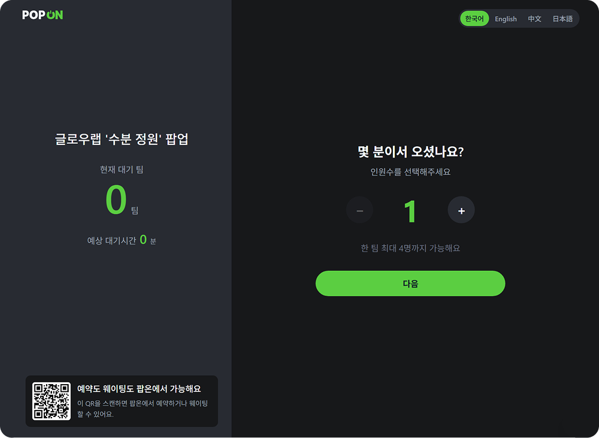
</p>
<p align="center">
  
</p>

> 기능별 동작은 아래 [주요 기능](#주요-기능)에서 GIF로 볼 수 있습니다.

<br>

## 프로젝트 개요

| 항목 | 내용 |
|---|---|
| 기간 | 2026.07 – 2026.08 (약 1개월) |
| 인원 | 4명 (프론트엔드 2, 백엔드 2) |
| 과정 | 대한상공회의소 [IBM] Cloud Native Dev base AI Agent 4기 팀 프로젝트 |
| 내 역할 | **소비자 웹 · 현장 체크인 화면 설계 및 프론트엔드 개발** |

### 왜 만들었나
인기 팝업스토어에는 짧은 기간에 사람이 몰립니다. 
방문객은 가보기 전까지 대기 상황을 알기 어렵고,
현장에서는 직원이 줄을 정리하고 입장을 안내하기 바쁩니다.

팝온은 "가기 전에 알고, 도착하면 바로 줄 서고, QR로 입장하는" 흐름을 목표로 삼았습니다.
- 방문객: 실시간 혼잡도와 예상 대기시간을 보고, 사전 예약이나 현장 웨이팅 중 선택
- 현장 관리: 태블릿 셀프 웨이팅 등록과 QR 입장으로 직원 응대 부담 감소
- 팝업 주최자: 사전예약과 현장 웨이팅을 하나의 대기열 보드에서 관리


<br>

## 구성

하나의 백엔드와 사용자별로 나뉜 4개의 프론트엔드로 구성

| 앱 | 대상 | 주요 기능 | 기술 | 담당 |
|---|---|---|---|---|
| [**소비자 웹**](Frontend/customerfrontend) | 방문객 | 팝업 탐색 · 지도 · 예약 · 웨이팅 · 입장 QR · 후기 | Next.js 16 | **본인** |
| [**현장 체크인**](Frontend/checkinfrontend) | 현장 손님 · 직원 | 태블릿 셀프 웨이팅 등록, 입장 QR 스캔 | Next.js 15 | **본인** |
| [**주최자 센터**](Frontend/popupfrontend) | 브랜드 · 셀러 | 팝업 등록, 예약 관리, 통합 대기열 관제, 성과 분석 | Vite + React | 팀원 |
| [**관리자 콘솔**](Frontend/adminfrontend) | 플랫폼 운영팀 | 팝업 심사, 회원 · 콘텐츠 관리, CS, 통계 | Vite + React | 팀원 |
| [**통합 백엔드**](Backend) | 공통 | 4개 앱이 함께 쓰는 REST API | Spring Boot 4 | 팀원 2명 |

각 폴더의 README에 화면별 기능과 실행 방법이 정리되어 있습니다.

<br>

## 주요 기능

### 소비자 웹

| 홈 · 탐색 | 검색 · 필터 |
|:---:|:---:|
| 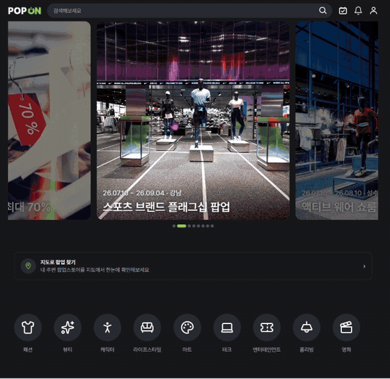 | 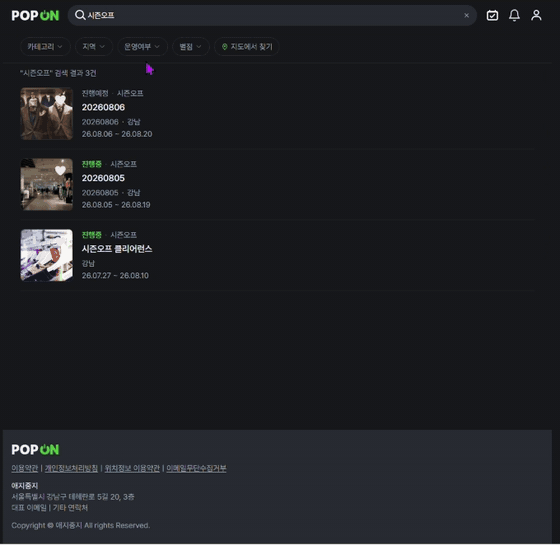 |
| 배너, 카테고리, 실시간 혼잡도, 인기 랭킹 | 카테고리 · 지역 · 운영 여부 다중 필터 |
| **사전 예약 → 입장 QR** | **팝업 상세 · 후기** |
| 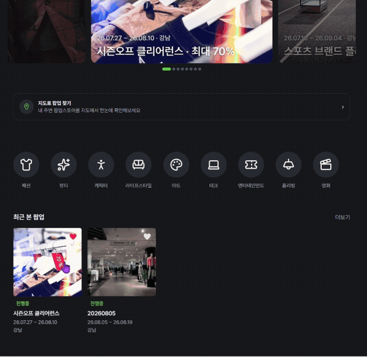 | 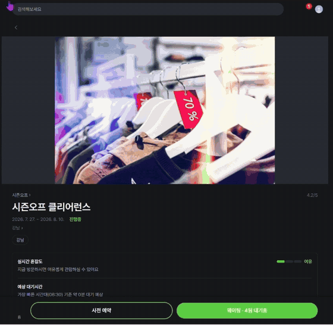 |
| 날짜 · 시간대 선택 후 바로 입장 QR 발급 | 혼잡도 · 대기시간 확인, 후기 필터 · 신고 |
| **후기 작성** | **지도로 찾기** |
| 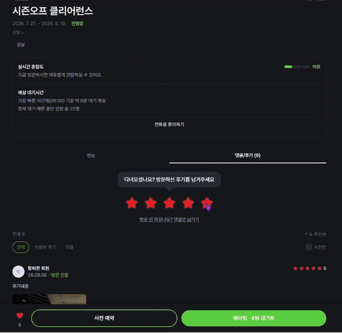 | 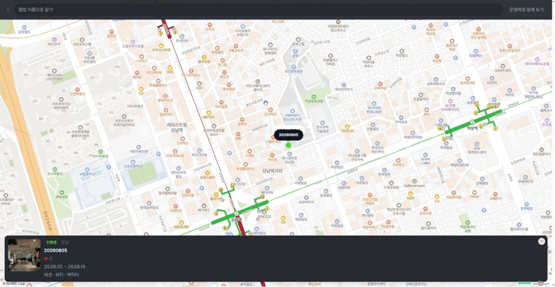 |
| 별점 · 사진 첨부(1:1 크롭) | 네이버 지도 위 진행 중 팝업 표시 |

### 현장 체크인

| 셀프 웨이팅 등록 | QR 입장 처리 |
|:---:|:---:|
| 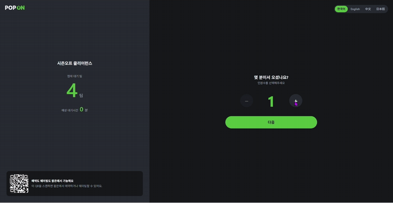 | 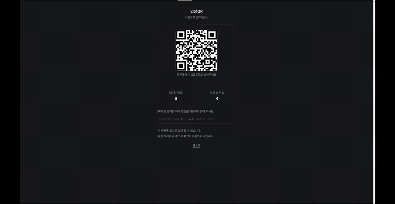 |
| 인원 → 연락처 입력, 대기번호 발급 | 예약 · 웨이팅 QR을 카메라로 스캔해 입장 |

### 주최자 센터

| 서비스 소개 사이트 | 팝업 등록 |
|:---:|:---:|
| 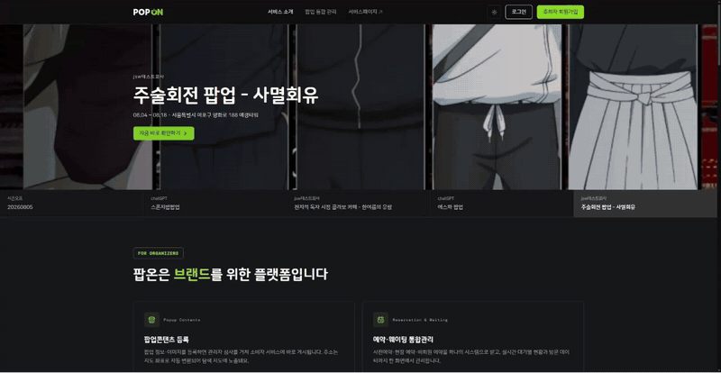 | 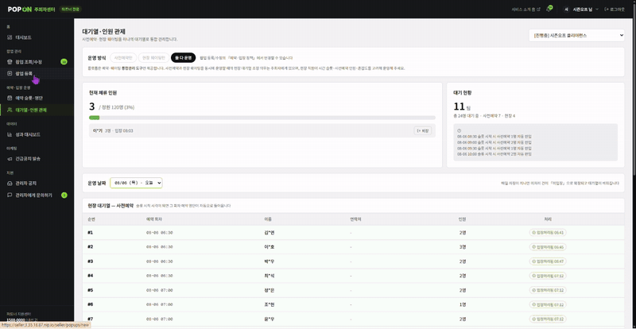 |
| 실제 팝업 데이터 기반 랜딩 | 운영시간 · 슬롯 · 정원 · 주소 · 이미지 입력 |
| **대기열 · 인원 관제** | **예약 슬롯 · 명단** |
| 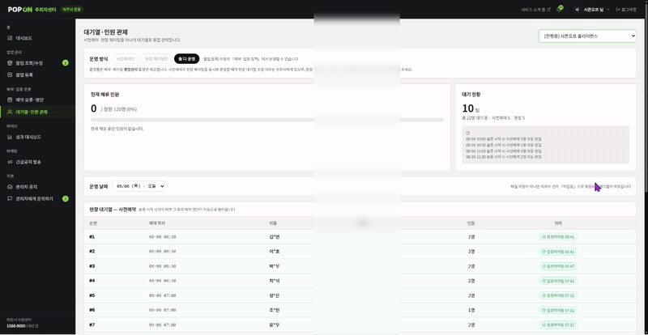 | 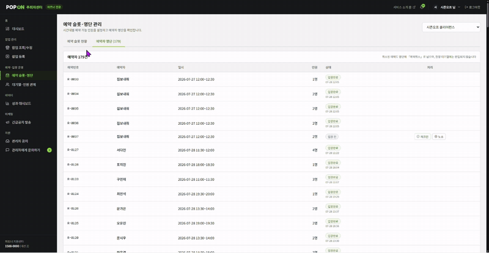 |
| 사전예약 + 현장 웨이팅 통합 보드 | 시간대별 예약 현황, 체크인 · 노쇼 |
| **성과 대시보드** | **긴급공지 발송** |
| 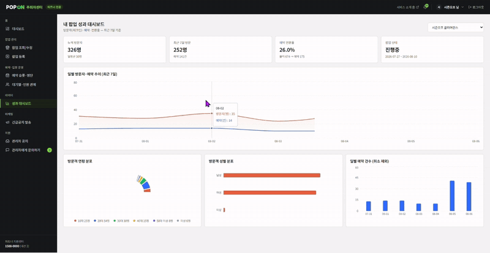 | 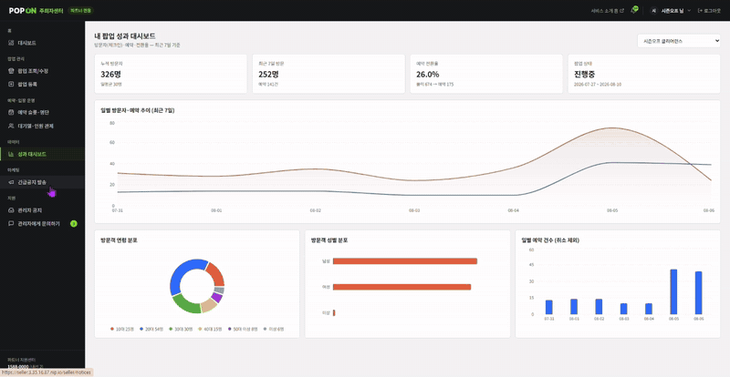 |
| 방문자 추이, 예약 전환율 | 팝업별 예약자에게 공지 발송 |

### 관리자 콘솔

| 대시보드 | 팝업 심사 |
|:---:|:---:|
| 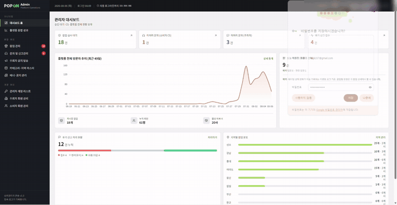 | 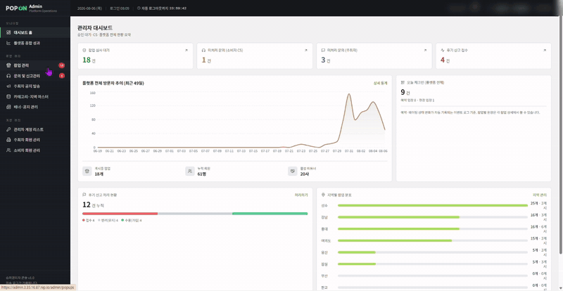 |
| 방문 추이, 처리 대기 현황 | 승인 · 반려 · 게시중지 |
| **문의 · 신고 관리** | **플랫폼 통계** |
| 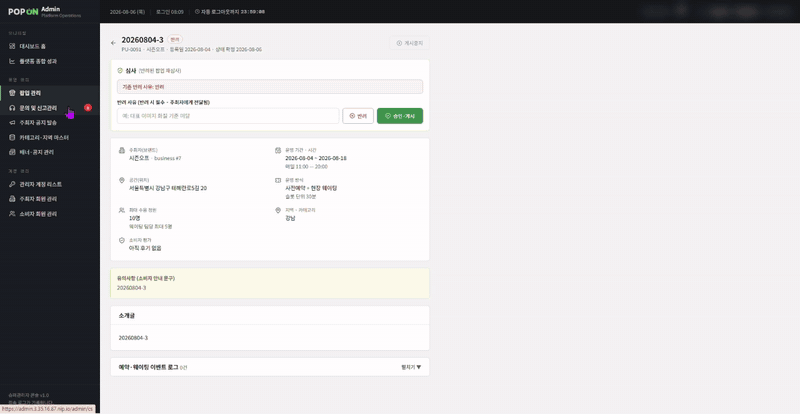 | 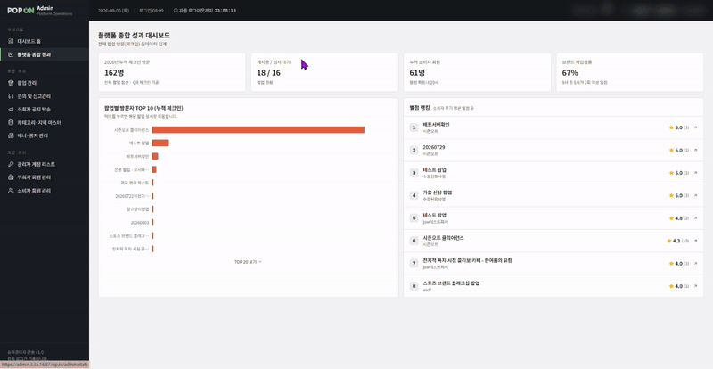 |
| 소비자 CS · 주최자 문의 · 후기 신고 처리 | 팝업별 방문자 · 별점 랭킹 |
| **배너 · 공지 관리** | |
| 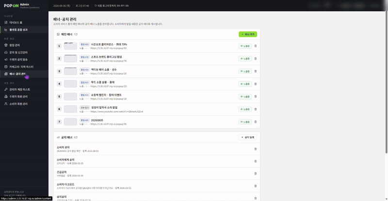 | |
| 등록한 배너가 소비자 홈에 바로 반영 | |

<br>

## 아키텍처

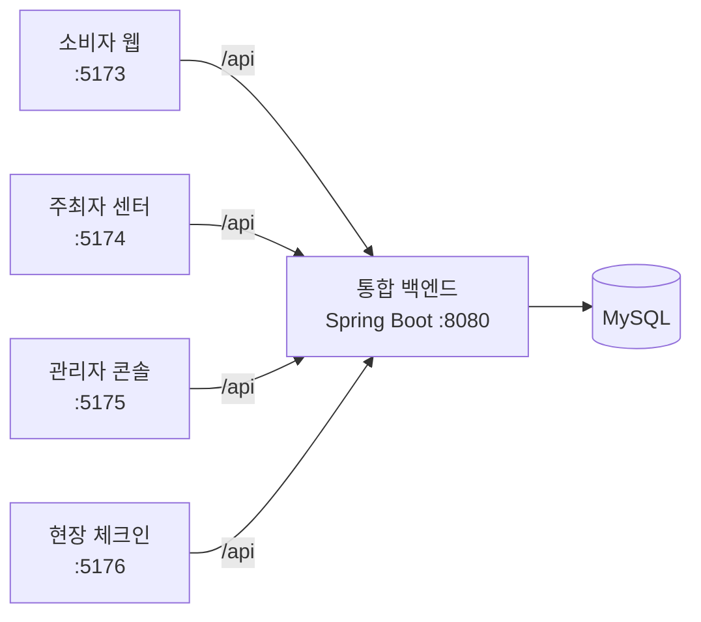

- 4개 프론트 모두 API를 상대경로 `/api`로 호출하고, 각 개발 서버의 프록시가 백엔드로 전달
- 역할(소비자 · 주최자 · 관리자)은 JWT 토큰 형식으로 구분하고, 소비자는 카카오 · 구글 소셜 로그인을 사용

<br>

## 기술 스택

| 영역 | 기술 |
|---|---|
| Frontend | TypeScript, React, Next.js, Vite, Tailwind CSS |
| Backend | Java 21, Spring Boot, Spring Security, JPA, JWT, OAuth2 |
| Database | MySQL |
| 외부 API | 네이버 지도 · 지오코딩, 네이버 SENS, 국세청 사업자 진위확인 |
| Infra | AWS EC2, nginx |
| Design · 협업 | Figma, GitHub |

<br>

## 내가 맡은 부분

### 소비자 웹
- 홈 · 검색 · 지도 · 팝업 상세 · 예약 · 웨이팅 · 마이페이지 등 **소비자 화면 전체 설계와 구현**
- **지도 핀 겹침 해결**: 같은 좌표는 일정 반경에 분산 배치, 화면 축소 시 픽셀 거리 기반 클러스터링
- **백엔드 장애 대응**: 연결 실패와 API 오류를 구분해, 연결이 끊겼을 때만 목업 데이터와 상태 배너로 화면 유지
- **예약 오류 예방**: 휴무 요일 · 지난 시간대 선택 차단, 중복 예약 방지
- UI 라이브러리 없이 Tailwind로 공용 컴포넌트 직접 구현, 다크 / 라이트 테마

### 현장 체크인
- 손님이 직접 쓰는 **태블릿 셀프 웨이팅 화면**과 직원용 **QR 입장 스캔 화면**
- 인원 → 연락처 순서로 입력 부담을 줄이고, 전화번호 · 이메일 중 하나만 받도록 개선
- 한국어 · 영어 · 중국어 · 일본어 4개 언어 지원
- 소비자 웹과 같은 대기시간 계산 공식 · 디자인 토큰을 써서 두 화면의 정보를 일치시킴

자세한 내용은 [소비자 웹 README](Frontend/customerfrontend)와 [현장 체크인 README](Frontend/checkinfrontend)에 있습니다.

<br>

## 폴더 구조

```
popon/
├── Backend/                   # 통합 백엔드 (Spring Boot)
├── Frontend/
│   ├── customerfrontend/      # 소비자 웹 (Next.js)
│   ├── checkinfrontend/       # 현장 체크인 (Next.js)
│   ├── popupfrontend/         # 주최자 센터 (Vite + React)
│   └── adminfrontend/         # 관리자 콘솔 (Vite + React)
└── docs/images/               # README 이미지
```

<br>

## 실행 방법

1. 백엔드: `Backend/src/main/resources/application-example.yml`을 `application.yml`로 복사해 DB · 키 정보를 채운 뒤 실행 → [자세히](Backend)
2. 프론트엔드: 각 폴더에서 `npm install` → `npm run dev`

| 앱 | 주소 |
|---|---|
| 소비자 웹 | http://localhost:5173 |
| 주최자 센터 | http://localhost:5174 |
| 관리자 콘솔 | http://localhost:5175 |
| 현장 체크인 | http://localhost:5176 |
| 백엔드 API | http://localhost:8080 |

## 배포

프로젝트 기간 동안 AWS EC2에 배포해 실제 환경에서 운영했습니다.
**현재 서버는 종료되어 접속할 수 없고**, 동작 화면은 위의 [주요 기능](#주요-기능) GIF로 확인할 수 있습니다.

| 구성 | 방식 |
|---|---|
| 통합 백엔드 | Spring Boot jar를 EC2에서 systemd 서비스로 상시 구동, 설정 파일은 jar 밖에 분리 |
| 소비자 웹 | Next.js `standalone` 빌드로 필요한 파일만 추려 Node 서버로 실행 |
| 현장 체크인 | Next.js 정적 빌드(`output: export`) → nginx가 파일만 서빙 |
| 주최자 · 관리자 | Vite 정적 빌드 → nginx 서빙 |
| 라우팅 | nginx가 앱별 서브도메인 분리, `/api`는 백엔드로 프록시 |

**배포하며 해결한 문제**
- 구글 OAuth가 IP 주소를 리디렉션 URI로 허용하지 않아, nip.io로 IP를 도메인 형태로 바꿔 소셜 로그인 연결
- 업로드 이미지 URL을 절대주소로 저장했다가 서버 주소가 바뀌면 이미지가 깨지는 문제 → 상대경로로 전환
- 메모리 1GB 서버에 앱 여러 개를 올리기 위해, 서버 렌더링이 필요 없는 앱은 정적 파일로 배포
- 배포된 QR 코드가 localhost를 가리키던 문제 → 접속 주소에서 소비자 앱 주소를 자동으로 계산